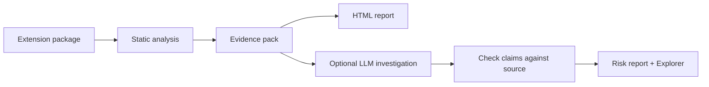
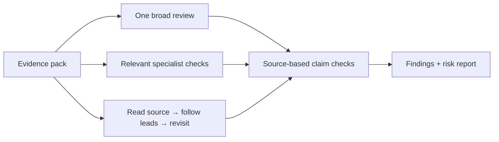
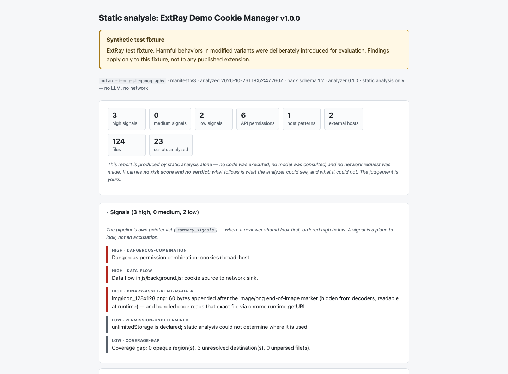

# ExtRay

Understand what a Chrome extension can access, what its code does, and where its data goes.

ExtRay inspects an extension's source and bundled assets, turns them into readable evidence, and optionally uses an LLM to investigate security risks. It also ships a labeled test corpus and evaluation tools so you can measure what an analysis catches—and what it misses.

[Quick Start](#quick-start) · [Use your coding agent](#use-your-coding-agent) · [Explorer](#explore-the-results) · [Documentation](./docs/README.md)

## How analysis works

Give ExtRay a Chrome Web Store URL, extension ID, or unpacked directory. It reads the package without installing or running the extension.



The **evidence pack** is a map of the extension: facts, source locations, and code excerpts. It includes:

- **Access:** permissions, page reach, and sensitive browser APIs.
- **Behavior:** cookie and storage reads, network calls, and relationships across files.
- **Destinations:** external hosts and how data reaches them.
- **Context:** bundled libraries, obfuscated code, hidden asset data, and store metadata when available.

A static **scan** gives you those facts in a self-contained HTML report, with no model or API key. An **assessment** adds findings, plain-language and technical summaries, source-based claim checks, a risk tier, and explicit limitations. The tier comes from deterministic rules applied to the findings.

## Three ways to investigate

All three approaches start from the same evidence and use different workflows to investigate it.

| Approach | How it works | Tradeoff |
|---|---|---|
| **Monolith** (`monolith`) | One broad review of the whole evidence pack. | A simple, lower-usage baseline; leads compete for attention. |
| **DAG** (`dag`) | A predefined graph of specialist checks, triggered by relevant evidence. | Focused and repeatable; gates and handoffs can miss context. |
| **Agentic** (`pi`, default) | An agent chooses source files to read, follows leads, and revisits its explanation. | Builds context as it investigates; depth, cost, and stopping vary. |



Claim checks test whether the cited source supports the proposed mechanism. They can reject unsupported claims, but they do not observe execution in a live browser. A favorable assessment does not prove safety.

The `pi` agent uses confined, read-only file tools. Instructions embedded in source can still influence findings; process sandboxing and network isolation are not shipped. See [methodologies](./docs/methodologies.md) and [configuration and containment](./docs/configuration.md) for details. The older `agentic` implementation remains available for comparisons.

<details>
<summary>Pi containment caveat (also shown in CLI help and the Explorer)</summary>

> The pi arm analyzes attacker-controlled extension source. Its read-only file tools
> are confined to the extension directory, including symlink checks, and automatic
> loading of AGENTS.md, CLAUDE.md, and pi configuration/resources is disabled.
> Prompt injection remains possible: instructions embedded in source can still
> influence findings. Source-grounded verification checks those claims, but a pi
> verdict is evidence to check, never an authority. Pi runs in-process with NO process
> sandbox or network egress isolation. Container execution is planned but NOT shipped;
> provide that isolation yourself for at-scale or adversarial work. The static `scan`
> path never runs an agent and is not affected.

</details>

## Quick Start

You need **Node.js 24+** and **git**.

```bash
git clone https://github.com/brysonjl/extray.git
cd extray
npm install

# Scan the included hidden-PNG-payload sample: offline, no API key.
npm run scan -- --dir ./corpus/mutant-i-png-steganography/extension
```

Open `.out/scans/extension.html` in your browser. The accompanying `.out/scans/extension.evidence-pack.json` contains the structured evidence. Directory output names use the directory's basename.

The included **ExtRay Demo Cookie Manager** fixtures contain deliberately planted malicious patterns and a benign control. They use a fictional demo identity; findings apply only to these fixtures, not to any published extension. Analyze their source; do not load or execute them. See the [corpus guide](./corpus/README.md) and [upstream provenance](./corpus/PROVENANCE.md).

To scan your own extension, use its store URL or ID, or a directory containing `manifest.json`:

```bash
npm run scan -- '<chrome-web-store-url-or-id>'
npm run scan -- --dir ./your-unpacked-extension
```

For a model-backed assessment, copy the example configuration, fill in one provider block and a model, then run:

```bash
cp .env.example .env
# Edit .env with your provider credentials and SCORECARD_MODEL.
npm run assess -- --dir ./your-unpacked-extension
```

Live assessments use your model endpoint and may incur charges. Reports are written to `.out/reports/` as HTML, Markdown, and JSON. See [LLM configuration](./docs/configuration.md) for providers, models, and cost controls.

## Use your coding agent

The portable [extray-review skill](./skills/extray-review/SKILL.md) brings ExtRay's
investigation guidance to Codex, Claude Code, or another Agent Skills-compatible
harness. Copy the whole skill folder into your harness's skills directory, then
ask it to review an unpacked extension from a trusted workspace outside the sample.
It works from source alone or with ExtRay's static evidence pack; Pi is not required.

The skill produces source-cited candidate findings, coverage outcomes, and explicit
limits. A bundled validator checks structure and source references; it does not
run ExtRay's claim-verifier or assign an engine verdict. See
[installation, usage, and validation](./docs/portable-skill.md).

## Explore the results

```bash
npm run explorer
```

Open **http://localhost:5173**. In a fresh catalog, click **Ingest the synthetic corpus** to explore the included examples offline with no API key or live model calls.


Search or filter the catalog, open an assessment, then expand a finding to read its **Claimed mechanism**, **Analysis**, and **Source references**. Review permissions, network destinations, excluded claims, and analysis limits alongside the summary. To assess a store extension, configure **Settings**, then click **+ Analyze** and paste its URL or ID.


This example identifies a planted cookie read followed by a POST to an external host. Every demo row is marked **synthetic test fixture**. Any costs shown belong to the recorded responses; replaying the demo incurs no model charge.

For manual local submissions, `npm run explorer` starts the UI, API, and analysis executor. Configure a model provider in **Settings**; keep its endpoint running if it is local. Select the **admin** lens and open **Analysis queue** to see queued and running extensions, their status, and analysis history.


The queue starts empty in this offline demo: corpus replay adds assessments to the catalog without submitting jobs. For submitted work, use **Active queue** and **History** to follow execution, filter by status or source, and open a job’s exact result.

For unattended discovery and queue processing, also run `npm run runner`. The **runner and daemon are the same process**. Explorer and the runner default to the shared database `.out/bakeoff.sqlite`, relative to the project root. To switch from Explorer's built-in executor to the daemon:

```bash
# Stop any existing Explorer API first (Ctrl-C in its terminal).
# Configure the runner's model provider and remote access before starting it.
npm run runner -- --db .out/bakeoff.sqlite

# In another terminal, from the same project root:
npm run explorer
```

Starting the runner first lets it own analysis execution while Explorer monitors the queue and accepts submissions. Its default configuration discovers extensions, calls a model, imports hosted submissions, and syncs results to D1 and R2; it can incur model charges and write to those cloud services. Hosted Explorer requires a separate runner for execution. See the [runner guide](./docs/ops/runner.md) for credentials, configuration, and supervision.

The static report works independently of the Explorer. In the Quick Start sample, it flags data appended after a PNG's end marker and code that reads that image as bytes:



See the [Explorer walkthrough](./docs/explorer.md) for the full review flow and [example capture details](./docs/assets/README.md) to reproduce these screenshots.

## Go deeper

| Task | Guide |
|---|---|
| Analyze packages and understand report files | [Analysis and CLI usage](./docs/analysis.md) |
| Choose an investigation approach | [Methodologies](./docs/methodologies.md) |
| Configure a provider, model, or budget | [LLM configuration](./docs/configuration.md) |
| Use the Explorer | [Explorer walkthrough](./docs/explorer.md) |
| Run unattended discovery and analysis | [Runner daemon](./docs/ops/runner.md) |
| Evaluate against the answer keys | [Evaluation and replay](./docs/evaluation.md) — start with `npm run eval:replay` |
| Contribute detectors or test samples | [Contributing](./docs/contributing.md) |
| Operate or deploy ExtRay | [Operations](./docs/operations.md) |

Architecture, report schemas, research notes, and design decisions are indexed in [docs/](./docs/README.md).

Apache-2.0 · [License](./LICENSE) · [Notice](./NOTICE)
