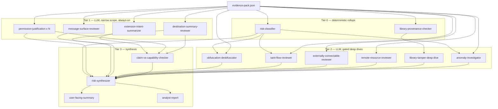

# Analysis DAG

The DAG consumes the [evidence pack](./static-analysis.md) and produces
a structured **risk report** (see
[`risk-report-schema.md`](./risk-report-schema.md) for the output
contract). Nodes are pure functions of their declared inputs: the
evidence pack subset they read, any upstream-node outputs they depend
on, and (for deep-dive nodes only) targeted source-file reads. Same
inputs ⇒ same outputs ⇒ cacheable per node.

## Coverage discipline

The DAG is bounded by what the static pipeline could observe. Several
structural blind spots always apply: library files skipped from sink
analysis, shallow taint depth, partial sink coverage for indirect
exfil channels, opaque dynamic code, invisible runtime state. The
canonical list lives in `risk-report-schema.md` under "Epistemic
limits."

Two rules follow for nodes that produce findings:

- A node that judges a concern *not* to be present (a dismissal) must
  emit a `contributing_nodes[].contribution: "dismissed"` entry with
  the checks it actually ran, never a clean-bill-of-health verdict.
- Positive findings — the synthesizer's `severity: "positive"` —
  require `coverage_caveats[]` naming the blind spots that apply.
  Without caveats, the synthesizer rejects the finding at composition
  time.

The `risk-synthesizer` and `user-facing-summary` nodes consult
`verdict.coverage` before surfacing positive findings to
non-technical readers.

## Why a DAG, not an agent loop

- **Repeatability.** Fixed topology means the same extension produces
  the same set of node invocations every time. Easy to diff across
  versions of the same extension or across runs of the same code.
- **Predictable cost.** We know in advance which nodes will fire and
  roughly what token budget each consumes. Gating nodes (described
  below) keep expensive nodes from firing when nothing warrants them.
- **Parallelism.** Independent nodes run concurrently. The scheduler is
  trivial.
- **Auditability.** Every finding in the report traces to a specific
  node's output, which traces to specific evidence-pack facts. There
  is no "the agent decided to look at X" — either a gate fired or it
  didn't.
- **Per-node caching.** A node's output is keyed on a hash of
  `(node_version, input_subset, model_id)`. Re-runs on the same
  extension after a code change to one node only re-execute that node
  and its descendants.

The cost is reduced flexibility. If a finding needs open-ended
investigation, that investigation lives inside a single node — not
spread across the pipeline.

## Node contract

Every node has the same shape:

```
node {
  id:              "permission-justification"
  version:         "1.0"
  inputs:          [evidence-pack JSONPaths, upstream node ids]
  gate:            (evidence-pack) -> bool        // does this node run at all?
  kind:            "deterministic" | "llm"
  model:           "haiku-4-5" | "sonnet-4-6" | "opus-4-7" | null
  source_access:   "none" | "snippets-only" | "targeted-reads"
  output_schema:   { ... }
}
```

A node may fan out: a single per-permission node spec may produce one
invocation per declared permission. The DAG records each as a distinct
cached unit.

## Topology



## Node specs

### Tier 0 — deterministic rollups

**risk-classifier** (deterministic). Reads `manifest_analysis`,
`cross_file.permission_usage`, `cross_file.destination_summary`,
`scripts[].obfuscation`. Assigns each evidence-pack fact a coarse
risk tier (`info`/`low`/`medium`/`high`) by rule lookup. Output is a
flat list of `{fact_ref, tier, rule_id}`. This is what gates downstream
deep-dive nodes.

**library-provenance-checker** (deterministic). Reads `files[]`.
Confirms each vendored library matches its expected hash; flags
mismatches, missing entries, or vendor-path files with no provenance
match. Output: `{verified: [...], suspicious: [...]}`.

### Tier 1 — narrow-scope LLM nodes

These always run. Each gets a small slice of the evidence pack, not the
whole thing. Model defaults to Haiku unless noted.

**extension-intent-summarizer**. Inputs: manifest name, description,
`_locales/*/messages.json`, options page HTML titles, store-listing
text if available. Output: a 2–3 sentence "what does this extension
claim to do" paragraph. Feeds `claim-vs-capability-checker`.

**permission-justification** (fan-out: one invocation per declared
permission). Inputs: the permission, its `cross_file.permission_usage`
entries, snippets for each call site (already in evidence pack).
Output: `{permission, justification: "...", judgment: "justified" |
"weakly-justified" | "unjustified" | "unused", reasoning, evidence_refs}`.

**destination-summary-reviewer**. Inputs:
`cross_file.destination_summary`, the intent summary. For each host,
classify as `expected-for-purpose` / `infrastructure` (CDN, analytics,
error reporting) / `suspicious` / `unknown`. Flag any dynamic
destinations.

**message-surface-reviewer**. Inputs: `cross_file.message_graph`,
listener snippets, `manifest_analysis.externally_connectable`. Judges
whether message boundaries are validated and whether
`externally_connectable` exposes risky surface.

### Tier 2 — gated deep dives

These only fire when their gate condition is met. Each is allowed to
read full source files via `targeted-reads`.

**obfuscation-deobfuscator**. Gate: any `scripts[].obfuscation.flagged
== true` for a first-party file. Model: Sonnet. Reads the full file,
attempts a best-effort static decode of string arrays / packers, and
re-runs Layer-3-style sink extraction over the decoded form. Output:
`{decoded_sinks, decoded_destinations, decoder_confidence}`. Result is
fed back into `risk-synthesizer` alongside the original (potentially
sanitized) sinks.

**taint-flow-reviewer**. Gate: any `scripts[].taint_sketches[]` with
classification touching cookies/storage/identity → network/code-exec.
Model: Sonnet. For each chain, reads the relevant file regions to
verify the chain is real (not a false positive from shallow analysis)
and to characterize what data actually flows. Output: per chain,
`{real: bool, data_classification, severity, narrative, evidence_refs}`.

**externally-connectable-reviewer**. Gate:
`manifest_analysis.externally_connectable` non-null or contains
wildcards. Model: Sonnet. Reads handler bodies to assess whether the
extension safely brokers external requests.

**remote-resource-reviewer**. Gate: `resources.html[]` contains remote
scripts/iframes, or any HTML contains inline scripts. Reads the HTML
and inline scripts.

**library-tamper-deep-dive**. Gate:
`library-provenance-checker.suspicious` is non-empty. Model: Sonnet.
For each unverified vendor file, reads it and identifies whether the
divergence from the claimed library is benign (modified config, minor
version) or hostile (injected sinks, exfil endpoints). This catches
the classic "malicious update injects code into jquery.min.js"
pattern.

**anomaly-investigator**. Gate: any `files[].anomalies` non-empty.
Per-anomaly judgment of whether it represents a real concern.

### Tier 3 — synthesis

**claim-vs-capability-checker**. Inputs: intent summary, permission
judgments, destination review. Asks: does the extension's declared
purpose explain its declared capabilities and observed behavior? Each
mismatch becomes a finding. Model: Sonnet.

**risk-synthesizer**. Inputs: every upstream node output. Produces a
deduplicated, ranked list of findings, each with: `{id, severity,
category, title, narrative, evidence_refs[], contributing_nodes[]}`.
Model: Sonnet (Opus only if the upstream signal volume crosses a
threshold). This is the closest thing the system has to a "verdict"
node, and it is deliberately constrained to *combine and rank*
upstream findings rather than introduce new ones.

**user-facing-summary**. Inputs: synthesizer output, intent summary.
A short, plain-language summary safe to show non-technical users:
"This extension can read cookies on every site you visit. It sends
data to one server, [host]. We did not find evidence of malicious
behavior, but [caveats]." Model: Haiku.

**analyst-report**. Inputs: full synthesizer output plus every
upstream finding. Long-form markdown report with every finding
expanded, evidence quoted, and reproduction steps where applicable.
Model: Sonnet.

## Execution model

- Nodes are scheduled by topological order. Independent nodes run in
  parallel. Per-invocation timeout enforced.
- Each node's output is written to a content-addressed cache keyed on
  `(node_id, node_version, hash(inputs), model_id)`. The DAG runner
  short-circuits to cache hits before invoking the node.
- A node failure is recorded as `{status: "error", reason}` rather
  than crashing the run. The synthesizer surfaces failed nodes
  explicitly so the analyst knows what was not evaluated.
- The full run produces:
  - `evidence-pack.json` (from the static pipeline)
  - `node-outputs/<node-id>.json` (one per executed invocation)
  - `risk-report.json` (synthesizer output)
  - `risk-report.md` (analyst report)
  - `summary.md` (user-facing summary)

## Adding a new check

Two questions:

1. Can the check be expressed as a static rule? If yes, add it to the
   appropriate static-analysis layer and emit a new field in the
   evidence pack. Bump `schema_version`. No DAG change needed unless
   you also want a new node to reason about it.

2. If it needs judgment, add a new node. Decide its gate, inputs,
   model, and whether it needs source access. Wire it into the
   topology. The synthesizer picks it up automatically once it appears
   in the contributing_nodes list.

The static pipeline and the DAG evolve independently. The evidence
pack is the only contract between them.
