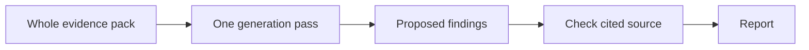
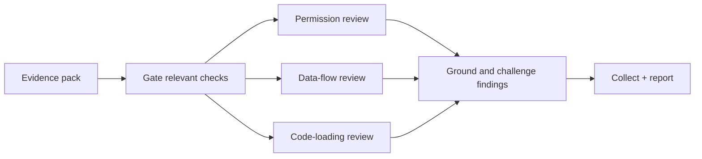
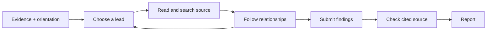

# Analysis methodologies

[Back to documentation](./README.md)

An investigation methodology generates findings from an evidence pack and source.
The project calls each implementation an **arm**. The main choices are
monolith, DAG, and the pi agent. Each exposes a different way to
investigate the same extension, rather than a different definition of risk.

## Monolith: one broad assessment



`--methodology monolith` reads the complete pack in one generation pass, then
uses the shared claim verifier. It is a useful baseline with relatively low
model usage. Competing leads share a single context; broad capability signals can
be overinterpreted and important mechanisms can be missed.

## DAG: a planned set of specialists

DAG means **directed acyclic graph**: a fixed workflow with dependencies between
checks. Evidence gates determine which specialist nodes run. Independent nodes
can run concurrently, and targeted source reviews check mechanisms. A challenger
reviews the candidate set before the results are collected.



`--methodology dag` makes the review path explicit and repeatable. Its gates,
specialist boundaries, and handoffs can also discard a lead or miss context.
The diagram groups checks by purpose; it is not a literal implementation node
count. See [DAG implementation](./dag-methodology.md) and
[conceptual graph](./analysis-dag.md) for the detailed topology.

## Pi: follow the evidence



`--methodology pi` is the default. The pi coding-agent harness chooses the next
source read, follows references and data relationships, and revises explanations.
Coverage requirements and a completeness critic reduce premature stopping.
Model choice, extension size, and stopping behavior affect both quality and
token usage. Evaluate the findings and coverage on the inputs you care about.

Pi generation is live-only and does not use the shared replay client. Its tools
are read-only and confined to the extension tree, but prompt injection remains
possible and full process isolation is not implemented. Read
[configuration and containment](./configuration.md#pi-containment-and-prompt-injection)
before adversarial or at-scale work. Current behavior lives in
`src/methodologies/pi/`; see [architecture](./architecture.md) for the shared
analysis and reporting contracts.

The older `--methodology agentic` arm uses a custom bounded investigation loop.
It is retained for comparisons. See the [legacy design](./agentic-methodology.md).

## Verification and verdicts

You can also use the [portable skill](./portable-skill.md) to investigate through
your own coding agent. It shares Pi's dimension briefs and classification guidance,
but produces a separate candidate report. Its local validation does not run the
shared claim-verifier or verdict engine described below.

The approaches share reporting rules. Behavioral claims are checked against
source; capability claims can be grounded directly in static observations. DAG
also performs checks within its specialist workflow. Refuted or unresolved
behavioral claims are excluded from confirmed behavior with reasons retained.
The deterministic verdict engine assigns the tier, and synthesis explains it.

A separate verifier model can challenge the generation model, but it is still a
model. Source support does not prove that a behavior ran, that a destination is
malicious, or that all harmful behavior was found. Review the report's limits.

## Run or compare approaches

After [configuring a model endpoint](./configuration.md):

```bash
npm run assess -- --dir ./your-unpacked-extension --methodology monolith
npm run assess -- --dir ./your-unpacked-extension --methodology dag
npm run assess -- --dir ./your-unpacked-extension --methodology pi

# Share one static evidence pack across the three approaches.
npm run assess -- --dir ./your-unpacked-extension --methodology monolith,dag,pi
```

Multi-arm reports include the methodology in their filenames. To compare quality,
use the [evaluation guide](./evaluation.md) and
[comparison loop](./methodology-comparison-loop.md), not only confidence labels
or an overall tier. The corpus answer keys are held separately from the analyzed
package so the analyst cannot simply read the intended answer.
